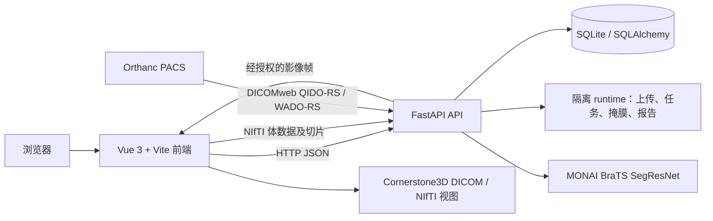

# BrainFusion-AI 架构说明

更新：2026-10-22。本文描述冻结候选 `BF-RC-20261021.1`、其独立几何修复分支和隔离验收运行时。这是教学科研工程原型，不是临床诊断或临床阅片系统。

## 组件与边界

- **前端**：Vue 3、Vue Router、Element Plus、Axios。病例、工作站、分析、研究和报告页面通过 API 读写业务状态；NIfTI 工作站提供序列切换、三正交视图和分割显示。Cornerstone3D 是阅片渲染层，不负责病例授权或影像来源判定。
- **后端**：FastAPI、SQLAlchemy。`backend/app/main.py` 注册病例、MRI、分析、报告、PACS、研究和本地身份 API。启动时会在 `DATABASE_URL` 指定的数据库建表并执行守卫式补列；因此只能对隔离数据库启动候选服务，正式数据库迁移须单独审批。
- **PACS**：Orthanc 是独立归档服务；DICOMweb 是客户端访问 Study、Series、Instance 元数据与影像帧的 HTTP 接口。BrainFusion 的 PACS API 做连接状态、来源核对、导入/转换审核和受控代理。Orthanc 不等于阅片器，Cornerstone 不等于 PACS。独立 Stage7 Orthanc 在 18142 保存合成验收 Study 和经人工批准的 UPENN-GBM-00001；隔离前后端对该归档完成了认证 QIDO/WADO 与 Cornerstone 实像素验收。正式 PACS 门控仍按配置关闭。
- **数据存储**：RC 使用独立 SQLite `E:\BrainFusion-Runtime\release-candidate\brainfusion-rc-20261021\runtime\brainfusion.db`；上传、任务和分析工件也在 RC runtime。正式服务原挂载的 runtime 在 `E:\BrainFusion-Runtime\results\nightly\2026-10-20\20261020T1815_real_nifti_compose_demo_fixed\runtime`，与 RC 分开，且本轮未启动或写入。
- **Docker**：RC Compose 文件为 `E:\BrainFusion-AI\docker-compose.rc.yml`，绑定 `127.0.0.1:18104`（API）和 `127.0.0.1:18184`（web）。RC 的模型只读挂载自 `E:\BrainFusion-Runtime\results\nightly\2026-10-10\20261010T000643_ec1cf8da\relocated-runtime\model`。独立 Stage 7 Orthanc 使用 `127.0.0.1:18142` 及命名卷 `brainfusion-stage7-orthanc-data`；不连接正式 Orthanc 卷。

## MRI 输入与模型路径

认可的分割输入是同一受试者、四个已识别序列（T1c、T1n、T2w、FLAIR），并满足项目的空间契约。DICOM 来源需先确认来源、身份、序列角色及隐私范围；各序列可以转换为 NIfTI，再检查方向、affine、spacing、origin、覆盖与 frame of reference。移动序列需按审核过的变换对齐到参考空间，并以 MRI 强度影像插值规则重采样。未经验证的序列不能仅因文件齐全而送入模型。

UPENN-GBM-00001 的四组 NIfTI 分别转换；源数据来自不同 Study/FrameOfReference。该病例已按隐私/数据使用审核导入隔离 Stage7 Orthanc，四序列 QIDO/WADO 和真实 Cornerstone 像素显示已通过。FLAIR/T2 的声明 `SpacingBetweenSlices` 与 IPP/IOP 实测中心距不一致；修复分支使用规则实测中心距构建阅片几何，并在 QC 中保留声明/测量差异。四序列三平面浏览通过不构成配准医学认可。当前 T1c 参考刚体配准及轴对齐 1 mm 输入仍是待人工审阅候选；没有对 UPENN 运行 SegResNet。

模型为集成的预训练 MONAI BraTS SegResNet。RC 已在隔离 Docker 后端中使用现有合格的 WAW-GliomAI 四序列工程样本完成一次真实推理；模型权重 SHA-256 为 `860ccb3f1c21c99d0410ad8a1ac4ef6b8fab60cec0a503b0ba42675741a750ae`。本项目自行实现输入检查、任务编排、推理调用、掩膜和区域体积持久化、病例/报告关联及前端显示；并未在此版本训练该模型。模型输出是工程分割结果，仍需有资质的读者复核，不能推断临床诊断、预后或模型泛化能力。

## 病例到报告的数据流

1. 用户创建病例并上传经许可的 NIfTI；病例、患者和 MRI 记录进入 SQLite，影像文件写到该环境的 `UPLOAD_DIR`。
2. 分析 API 为病例创建运行记录，核对四序列和输入路径后调用 SegResNet。
3. 运行状态、模型修订、输入摘要、掩膜路径和 WT/TC/ET 体积写入分析记录；掩膜作为单独文件保存在隔离 runtime。
4. 结构化报告绑定同一分析运行 ID。病例详情、分析历史和报告 API 读取这些持久化记录；服务重启后 RC 验证过结果与报告仍可读取。
5. 病例报告显示模型、区域体积、分析版本、输入/模型/掩膜摘要及“待复核”状态。报告是可追溯工程产物，不是医生签署的临床报告。

## 开源组件与项目代码

- 集成组件：FastAPI、SQLAlchemy、MONAI/PyTorch、NIfTI/DICOM 处理依赖、Vue 3、Vite、Element Plus、Cornerstone3D、Orthanc、Docker Compose。其具体版本以仓库锁文件、requirements 清单及镜像构建记录为准。
- 项目自有代码：病例和任务 API、权限与 fail-closed 门控、PACS/DICOMweb 代理和来源核对、转换登记与审核、分析编排、结果完整性与报告关联、研究输入登记及前端业务页面。
- 研究页面中的模型、组学、融合、IDH 或生存分析能力须逐项以功能矩阵中的测试状态为准。存在路由或实验代码不等同于已经完成临床验证。

## 当前运行边界

正式前后端现运行于 18100/18180，按 `production-preflight-20261021T205339` 审批包部署冻结 tag，部署验收为 PASS；本次只读复核仍见服务 healthy。正式数据库和病例 17/19 在本轮没有写入，正式 PACS 导入、像素读取和 AI bridge 门控未更改。Stage7 Orthanc 及独立测试前后端仅服务隔离验收。原冻结 tag 未修改；几何修复分支的候选镜像使用独立容器、端口和新 SQLite。
