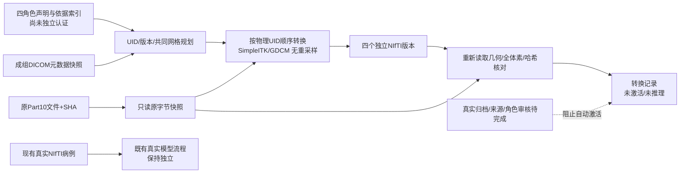

# P3-a / P3-b1 四序列来源规划与轻量转换工程验证

## 2026-10-13 06:10窗口（对应10/12夜至10/13清晨）

run_id 20261013T061054_a3334597；FileStream FileShare.None实际持有者/owner15416，原生启动UTC2026-10-12T22:10:53.6629913Z，开始UTC22:10:54.2786787Z/北京06:10:54，session15354；结束/实际耗时/正常释放见summary/lock-released。无新反馈，不编造REVIEW_FEEDBACK；保护现有大量工作树变更，不提交/推送/发布。

本轮新增P3-a四角色来源规划/拒绝契约、P3-b1原字节到NIfTI轻量转换工程验收。新增services/dicom_input_plan.py、dicom_conversion.py及各自tests、tools/plan_dicom_model_input.py、convert_dicom_model_input.py；study_validation.py抽取模型几何契约并用affine运算替代头部检查时的as_reoriented数据实体化，48种轴排列/翻转与旧affine计算一致。原模型四角色、共同矩阵/affine、1mm、轴对齐、每序列3200万体素约束不改变，归一化/模型/分割原mask不改。

规划要求四个不同Series、各一次t1c/t1n/t2w/t2f、同Study和FrameOfReference/原网格，逐项明确加权/对比剂阶段/液体抑制声明及依据SHA/索引/审核者索引/带时区时间；不按SeriesDescription猜。病例/归档fingerprint/实例与序列版本、实例完整集合与实际元数据重算空间一起核对，派生源索引到RAS毫米affine。确认JSON仅是声明，不认证审核者或医生，不证明许可或真实病例归档绑定。metadata_plan_ready只表示本规划检查通过，model_input_eligible始终false，真实证据/人工审核仍待完成。

转换复用现有SimpleITK2.5.6/ITK5.4的GDCMImageIO、pydicom3.0.2、nibabel5.4.2/numpy2.2.6，无新安装/下载。每个原Part10绑定UID与SHA、FileMeta和白名单元数据语义，先拒压缩/Deflate再读数据集；仅未压缩Little Endian经典非MOSAIC单帧MR。按已核对的IPP物理UID顺序读取，显式float32与stored*RescaleSlope+RescaleIntercept，ForceOrthogonalDirection=false；不加载私有/元数据字典，不自动配准/重采样。完整原字节快照另存、输出全新版本目录，不改原DICOM；只去除派生图像元数据，不能称已完成DICOM脱敏。

转换后重新打开四个NIfTI，核对尺寸、mm单位、RAS affine、qform/sform、每层每个像素和Rescale、全体素SHA、原DICOM/输出文件SHA与旧模型几何契约，空序列/不一致明确失败，保留失败版本不作成功状态。原文件单个64MiB/总1GiB、全序列/模型原有上限以及磁盘余量检查；原OB标准奇数像素偶数VL零填充明确支持，不补齐非法数据。BurnedInAnnotation=NO只是声明门槛，不代替真实像素审核。转换产物未激活到病例、不触发AI/归档/业务库；model_input_eligible仍false。GDCM内嵌版本本Python API未暴露，明确未记录，不能由ITK版本推算。

补齐requirements-core.txt遗漏的直接依赖httpx==0.28.1；当前PACS及新CLI导入它，而现环境早已安装。仅改声明，无pip安装/升级或整包重制；旧源码/CPU/worker交付包均历史，E6最终包未冒称更新通过。

验证：最终287相关后端通过/4既有警告（backend-final-resource.log），覆盖新规划/真实GDCM转换合成行为与原PACS/WADO/几何/阅片序列/世界测量/任务交互/分析完整性/config回归。首次38规划+几何、50转换子集、284补充前为历史；backend-final.log两项故障注入先丢失毫米单位而被更早正确拒绝，保留单位再注入affine/像素，并新增单位/qform冲突检查后通过。首次AST演示helper缺SERIES变量，未生成任何原DICOM，改用新engineering-fixture-final目录，失败空目录/日志保留。重启后审计工具错假定普通start_local登记frontend_mode，查实际命令与原生PID/启动时间后确认dev，没改/伪造运行登记字段。

独立进程实际CLI规划和转换通过：自有像素函数生成12个明确SYNTHETIC Part10（4角色各3层，3×2×3矩阵），负方向/分层Rescale产生四个NIfTI，72体素0差异、源快照/派生SHA可重开核查；独立手算RAS角点(column2,row1,plane2)=(-8,-21,28)mm一致。另有8位奇数填充、12位符号/Rescale/布局的测试，不将它们当真实采集或MRI队列。合成病例编号字段17只是测试上下文，archive_case_binding_independently_verified=false，未与原病例库建立关联。

现有合法真实NIfTI四序列240×240×155单独复验新头部几何检查，实际header-only约4.98ms、禁止像素实体化时仍通过、原文件SHA不变；没有声称与合成DICOM匹配，未重跑分割/特征/预测。这个时间只含本机本次头部检查；转换timing_ms含本合成样本的读写与独立核对，不是PACS导入、整条AI链路或真实队列性能，不能外推。

因共享校验参与现有MRI入口，活动分析/特征任务0后先备份并在副本验证14表全行和featurejobs复制SHA，再按既有脚本核验停止/重启。实际浏览器新服务原真实NIfTI Cornerstone仍3canvas、PACS未配置/旧WADO503/no-store、页面异常/原库写0，截图已查看。没有前端源码改动/构建、依赖安装或PACS环境重试；这是原入口相关回归，不是新真实DICOM/转换UI验收。

最终原14表全行与本轮备份/恢复副本、上轮已验副本相同；原MRI/mask/空间夹具/候选/隔离保管/任务文件SHA、包版本不变，无新schema/当前MRI/模型激活。只验业务库副本恢复，真实PACS索引/原文件+业务联合恢复仍未做。state-validation.json为重启前，state-validation-final.json才是重启后最终证据。

当前backend3096 UTC2026-10-12T22:44:52.3816824Z、frontend11740 UTC22:44:52.3890430Z；原项目dev，http://127.0.0.1:5179/case/17、workstation/17?viewer=cornerstone，API8012/docs。普通start_local登记没有frontend_mode/project/log键，按frontend-identity-final.json实际vite路径、无preview参数及原生启动时间确认dev，不假造登记字段。Runtime/local/processes.json及Runtime/local/{backend,frontend}.{out,err}.log；单后端/前端、各一串行worker，无长下载/训练/推理/构建。配置仍10/10 01:06 runtime-supported.json原DB/featurejobs/gate、00:06 relocated-runtime产物与Radiomics311-candidate；不把新增CLI说成容器/其他Python prefix已验证。

P1已验、P2工程a/b/c已验但总体进行中/P2-real受阻；P3-a/P3-b1仅工程已验，P3总体进行中/P3-real受阻：尚无真实匹配四序列/归档、可靠来源许可/像素审核与角色证据认证、病例转换版本激活/队列/UI、真实DICOM→现有AI端到端。本工具的JSON声明和元数据哈希不是患者/审核者认证。原UPENN单实例仍MOSAIC拒绝，MR_small为处理工程数据；本轮无新的真实数据下载或重复候选审计。P4待实施，E5受阻/E6进行中，R1待核查/R2–R4待实施，F/E历史验收保留。SCI/新临床指标/论文正结论未扩展。

下一轮第一步：锁、反馈、上述PID/原生启动和长任务核对后复用服务。新失败或可用真实PACS/合法同检查四序列优先返回P2/P3-real；外部条件仍不变则P3-b2转换版本重开/产物失效与来源完整性守护，以及病例只读来源状态接入（无可靠审核时仍不激活AI）。继续核实支持真实样本和角色实体证据，不重复旧空查询、同一次被拒安装或无变化整包构建。

Orthanc官方候选下载+版本执行此前自动审批仅“blocked by policy”，本轮未重试/换工具绕过；当前无Orthanc进程/私有PACS配置。解除需可获批准安装或已有可用归档，独立工程无需立即用户重复授权/账号/提权/重启。

用户抽查（06:10窗口，最多五项）：

1. 输出SYNTHETIC-input-plan.json应为metadata_plan_ready、有四个角色/来源版本、model_input_eligible=false，审核标记是supplied_declarations，不能当医生确认。
2. 输出SYNTHETIC-conversion-report.json应为converted_and_verified、data_role=synthetic-fixture，四份NIfTI各18体素/共72，误差0、源UID/Frame/原DICOM和输出SHA齐全；inference_performed=false。
3. real-nifti-header-regression.json应为existing_real_NIfTI_study_not_DICOM_conversion，四份240×240×155、原SHA不变、未连到合成来源。
4. 打开 http://127.0.0.1:5179/workstation/17?viewer=cornerstone，真实原NIfTI仍三视图；回病例17刷新归档，应仍尚未配置，没有自动使用本合成转换文件。
5. state-validation-final.json应显示原14表/科学与任务SHA/依赖不变、当前3096/11740服务；PACS未配置、real_matching_DICOM_four_sequence_end_to_end=false。

## 来源与产物关系（工程实现，真实链路仍受阻）

## 官方依据与复现

采用[SimpleITK官方序列读取说明](https://simpleitk.readthedocs.io/en/master/link_DicomSeriesReader_docs.html)及[ImageSeriesReader API](https://simpleitk.org/doxygen/latest/html/classitk_1_1simple_1_1ImageSeriesReader.html)。文件列表按源患者层位排序，本实现不按名称/InstanceNumber排序，不隐式取目录第一个Series；列表由已经核对的完整UID和IPP/IOP结果生成，读后再核对几何和每个像素。官方示例页显示2.4文档标识，实际运行版本记录为2.5.6/ITK5.4，不混用版本。现用依赖由requirements-core及requirements-dicom-preflight固定，pydicom3.0.2的FileMeta header API先拒绝Deflate，未执行新下载或其他prefix配置。

角色输入为t1c=T1/post/无液体抑制，t1n=T1/pre/无液体抑制，t2w=T2/不适用对比阶段/无液体抑制，t2f=T2/不适用对比阶段/液体抑制的明确声明规则。这不是依据TR/TE或名称自动证明MRI加权的算法；实体证据索引/SHA目前由调用者提交，未独立解析或认证，真实角色确认仍未验。初版跨Study/不同Frame/不同原网格明确拒绝，不能用同患者名称替代几何和来源核查。

API元数据原始JSON revision保留；额外语义SHA只用于DICOM文件与DICOM JSON之间DS/IS合法数字/字符串表示比较，实际数值变化仍拒绝，不把元数据SHA当原文件SHA。Rescale是显式强度映射，不是配准/重采样或像素烧录处理。原文件/源快照保留全部原字节，派生NIfTI无原姓名元数据并不意味着输入完成脱敏。

证据目录：E:/BrainFusion-Runtime/results/nightly/2026-10-13/20261013T061054_a3334597/。

- backend-final-resource.log：287最终通过/4既有警告；backend-first、conversion-first、accepted为前述历史。backend-final.log两项故障注入格式失败保留，不当通过。
- engineering-fixture-final/：明确合成原Part10和proposal/snapshots/source-files及初始SHA；它们由自有像素函数生成，不是NIfTI回造DICOM/真实采集。
- SYNTHETIC-input-plan.json、plan-cli.log、SYNTHETIC-conversion-negative-scaled/conversion-report.json、conversion-cli.log：独立实际CLI、四NIfTI原文件与快照保留在Runtime；输出只复制可读记录，不把大数据放仓库。
- real-nifti-header-regression.json：真实原NIfTI单独头部回归；不与合成计划建立谱系。
- database-backup/validation.json、restart-guard.json、feature_jobs_snapshot、state-validation-final.json：本轮业务副本恢复和最终全行/文件核对。source数据库仍原址，无schema变化。
- browser-wado-boundary/validation.json及actual-pacs-status.png：共享校验重载后真实NIfTI3canvas、实际未配置PACS/no-store；不是转换UI或真实DICOM验收。
- frontend-identity-final.json、services-reuse-final.log、processes-final.json：当前原项目dev与PID/启动身份，无长任务。

本轮未修改前端/添加另一套UI；未开放DICOM模型按钮、病例转换激活、DICOM SEG/SR或医生mask编辑。PACS与业务联合恢复、真实转换性能与内存仍P4待验。旧包保持历史，HTTPX依赖声明变更后也不能声称旧包已含新模块。
