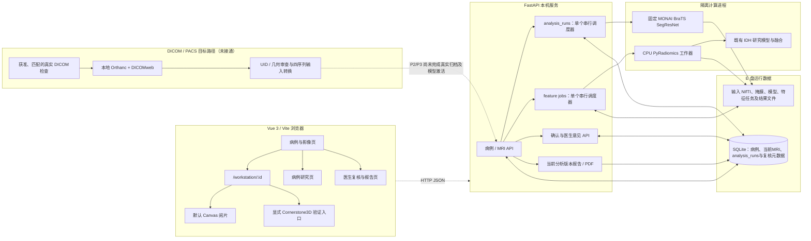
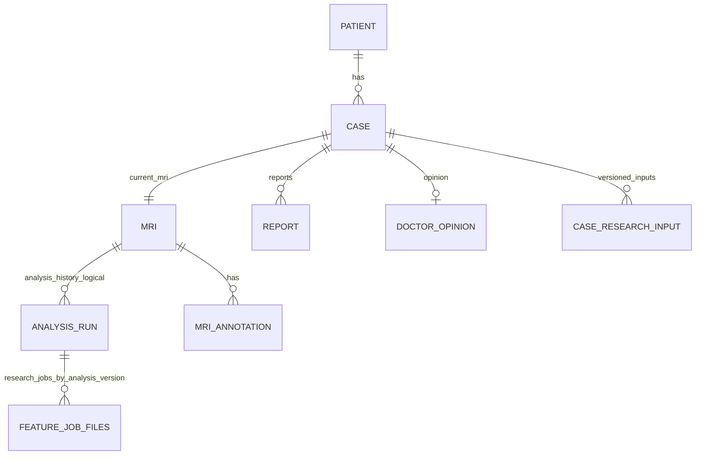

# BrainFusion AI — 系统架构

更新：2026-10-14 02:06（北京时间）。本图区分已验收的本机NIfTI路径与尚未接通的DICOM/PACS计划；不把工程接口、安装包或组件文件当作实际归档服务。

## 当前架构与边界

Cornerstone3D入口目前用于已验收的NIfTI阅片迁移路径；病例工作站默认仍为Canvas，切换Cornerstone是明确操作。两者都没有接入真实DICOM/PACS影像。当前模型输入要求同一患者的T1c、T1n、T2w、FLAIR四个已配准、共同网格的NIfTI序列；不自动配准或重采样。DICOM转换/来源接口和UI工程不表示真实检查已导入，也不允许直接激活AI。

## 当前处理链

1. Vue客户端通过FastAPI读取病例和影像；MRI文件与预览/分析产物存于E盘，SQLite保存业务关系和版本元数据。
2. 分割任务以queued/running/succeeded/failed记录；同一后端只有一个串行调度器，工作器在独立子进程执行固定MONAI BraTS SegResNet。成功结果绑定四序列输入、mask和模型来源摘要；医生确认绑定分析版本。
3. 研究特征任务由另一个串行调度器管理，再调用隔离CPU PyRadiomics进程，按冻结协议提取选定特征，之后读取既有研究模型与临床输入计算探索性结果。临床或分析版本变化会使旧研究结果不再显示为当前结果。
4. 医生意见独立保存；报告/PDF绑定当前分析版本，研究概率不自动写入诊断建议。报告的浏览器导出和两页PDF分页/可读性已有本机NIfTI路径局部验收。
5. 服务重启会将未完成的分割/特征任务标为失败并保留日志/版本，不假装自动续跑；已完成结果按业务库和文件快照恢复方案读取。已验收的是SQLite与相关产物副本恢复，真实PACS归档索引和原文件尚未加入联合恢复。

## 主要关系

MRI.case_id与Case.mri当前为一对一ORM关系；AnalysisRun.mri_id和Report.analysis_run_id目前通过字段逻辑绑定版本，不能仅凭ER图推断数据库外键约束。特征任务请求、状态、日志与结果文件保存在配置的FEATURE_JOBS_DIR，而不是SQLite独立任务表。分割结果/输入影像本体也以E盘文件存储，SQLite记录定位与版本关系。

## 已核实实现与尚未完成部分

| 部分 | 当前事实 | 状态边界 |
|---|---|---|
| Web与病例工作流 | Vue 3/Vite；病例、阅片、研究、复核和报告页面 | 本机HTTP路径有既往实际浏览器回归 |
| NIfTI阅片 | Canvas默认入口；显式Cornerstone3D三视图路径 | 受支持NIfTI路径已验收；Cornerstone/DICOM不等同 |
| 分割 | 固定MONAI BraTS SegResNet权重；原空间mask | 真实公开开发样本已跑通；不代表临床性能 |
| 影像组学 | 独立CPU PyRadiomics工作器，固定协议 | 当前工程样本可复现；自动掩膜模型未按队列重拟合 |
| PACS / DICOMweb | 计划使用本机Orthanc与DICOMweb | 本机当前未部署/配置实际归档；没有真实DICOM到模型闭环 |
| Docker与跨机部署 | Docker Compose文件和安装文档存在 | 容器重建、持久化及异机部署未验收 |

架构证据与实际操作见[P1 Cornerstone验收](P1_CORNERSTONE_VALIDATION.md)、[P3转换完整性边界](P3_CONVERSION_INTEGRITY_VALIDATION.md)、[数据快照与恢复](SYSTEM_BACKUP_RESTORE.md)、[工程论文素材](THESIS_ENGINEERING_MATERIALS.md)及当前完成台账。P2/P3/P4、E5/E6与R1–R4整体状态仍以完成台账为准。