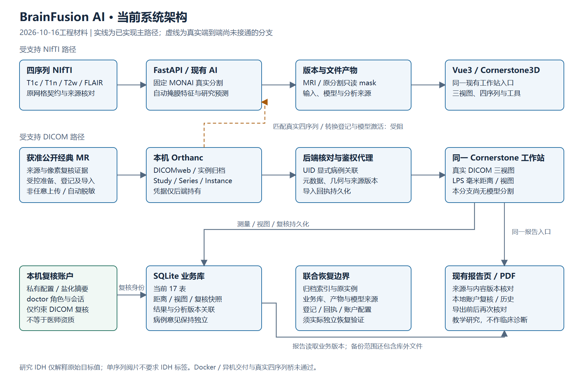
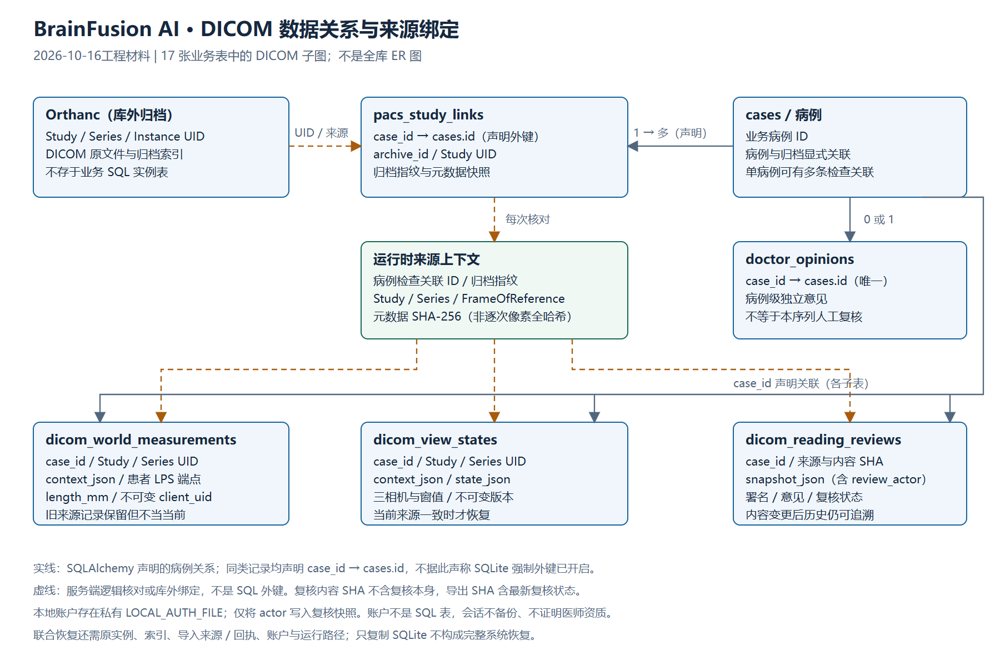
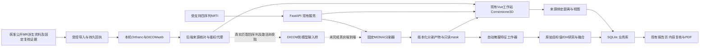
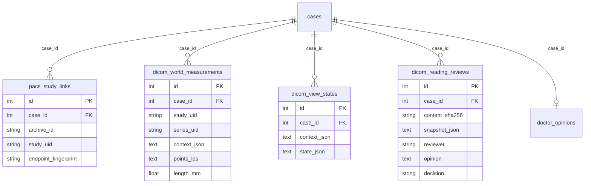

# 当前系统架构与DICOM结果关系

## 2026-10-16 已导出并查看的当前图稿

[两张SVG/PNG与来源说明](E6_ARCHITECTURE_FIGURES.md)已通过实际源码关系核对、Edge渲染/文字边界与逐图查看。下面Mermaid仍保留可编辑关系源，旧“未渲染”文字仅为当时记录。账户DICOM最小组合已实际CLI/活服务/重启验证，完整新账户19病例数据组合已实际恢复/重启，独立安装交付另待最终验收；当前Edge NIfTI与DICOM保存/正常关闭、DICOM账户/PDF明确范围已有证据。

当前P2受支持经典MR本机导入/关联/Cornerstone范围已验，来源准备v2真实分支证据见[P2验收](P2_V2_REAL_IMPORT_VALIDATION.md)。新私有账户最小联合组合已实际接通，旧17表全量bundle历史不变；两张当前图稿如上。完整新账户19病例数据组合已实际恢复；真实匹配四序列模型桥仍受阻，代码/环境联合安装及异机部署待验。

2026-10-15夜间工程材料。以代码、已验范围和17表联合恢复为依据；这是Mermaid源图，未在本轮导出/审核位图或论文排版，不把源图存在当图稿验收。

## 运行与数据路径

浏览器不持有Orthanc服务凭据；后端保留受支持像素、来源与归档身份保护。图中受控资料入口不是任意文件自动脱敏。普通单序列阅片不依赖IDH标签或四序列齐备。DICOM病例19当前没有模型分割/预测，不能借用NIfTI病例17的结果填入其报告。真实NIfTI模型与研究结果保持原来源；未知IDH编码仅按原始目标值解释，非临床风险。

## 数据库声明关系及跨归档绑定

图示SQLAlchemy声明关系，不据此声称跨归档由SQL外键自动强制一致。距离/视图的context与复核snapshot还绑定病例检查关联ID、归档指纹、Study/Series/FrameOfReference UID及元数据摘要；没有额外的SQL序列表或Instance表。归档实例由Orthanc管理，导入回执及来源证据保存在E盘文件中，不能只备份SQLite。

病例医生意见是独立病例级记录，未自行变成序列复核。复核另存不可变完整快照；来源、距离或意见变化后历史过期，原文不丢。内容SHA不包含复核本身以避免循环；导出SHA包含最新复核状态，导出前后重新核对，旧页不能将过期内容当当前结果。当前新复核在snapshot_json绑定本地账户ID/角色，doctor角色方可POST；旧行继续未认证。独立LOCAL_AUTH_FILE保存盐化摘要/账户配置，内存会话重启失效，不新增SQL表。此权限仅覆盖DICOM复核，不是全站医院RBAC，不能作为实名/医师资质证据。

## 恢复与交付边界

完整恢复组合是Orthanc索引/实例/私有配置、业务17表、应用产物/模型来源、导入登记/回执及运行路径；当前账户配置另作私有补充备份（10/15旧bundle未收录；10/16新工具自动收录的最小DICOM/账户组合已活服务验收，完整新19病例含账户数据组合已在05:18窗口通过，源码/环境安装交付另验）。正常停机、离线核对复制、独立目录实际启动、来源/版本/世界坐标及浏览器核对后，恢复正式配置；私有凭据不随公开材料分发。已验同机17表组合，不宣称Docker、异机环境、医院现网PACS或DICOM SEG/SR回写。

最新实证见 [17表联合恢复](P4_JOINT17_RECOVERY_VALIDATION.md)、[报告边界](P4_REPORT_BOUNDARIES_VALIDATION.md)、[P1测量与视图](P1_MEASUREMENT_VIEW_VALIDATION.md)。旧论文图表仅代表当时工程版本；现有SCI/外部独立评价、四序列桥和全站/多用户部署的门槛分别保留，本地复核账户最小范围见[当前验收](P4_LOCAL_REVIEW_IDENTITY_VALIDATION.md)。
